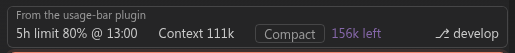

# usage-bar

A Claude Code mod that shows one line above the prompt:



- **5h limit**: how much of your 5-hour usage limit is used, and the time it resets
- **Context**: how many tokens the context holds
- **Compact**: how many tokens are left before auto-compaction; click it to compact now
- **Cache** (desktop app only): minutes left on the 1h prompt cache since the last request, and the time it expires

It also shows the current git branch on the right, or "not in repo".

Based on [usage-ring](https://github.com/edwin-sal/usage-ring) by Edwin.

## Develop

```bash
claude plugin validate .
claude plugin test .
```

## Install

```
/plugin marketplace add jligeza/usage-bar
/plugin install usage-bar@usage-bar
```
